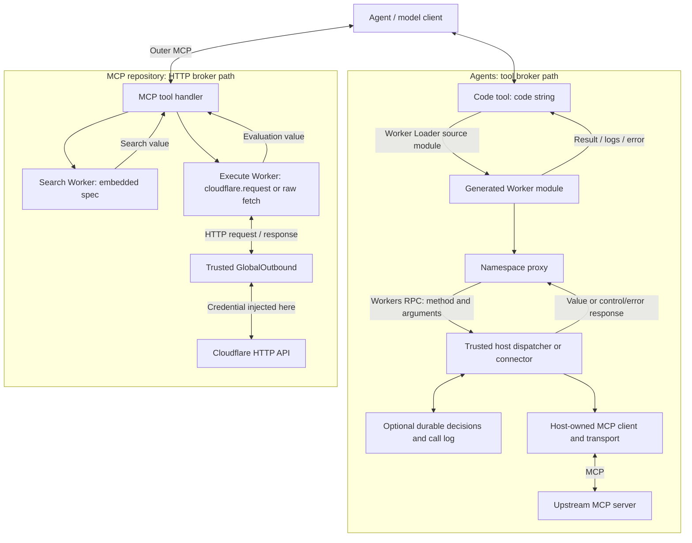

# Cloudflare Code Mode: REA investigation for Wyrit

Date: 2026-10-24. Purpose: understand externally useful contracts and execution boundaries for an independent, open-source, local-first Wyrit design. This is research, not a proposal to reproduce Cloudflare's implementation. No Wyrit implementation or upstream source changes were made.

The central finding is that **Code Mode is an agent interaction pattern with different execution backends**. The Agents package brokers tool calls over Workers RPC. The Cloudflare MCP service brokers HTTP requests through a credential-injecting outbound handler. Neither observed path requires generated code to own an MCP connection.

## Evidence and classification

- **OBSERVED**: behavior captured by REA during this investigation, under the declared local probe conditions. It does not imply production behavior or exhaustive security coverage.
- **SOURCE-VERIFIED**: directly established by the inspected source, including source retained by REA. Static syntax is never promoted to runtime observation merely because REA labels an AST fact “observed.”
- **INFERRED**: an architectural implication supported by evidence, with its reasoning stated.
- **UNKNOWN**: the available evidence does not establish the answer.

### Targets

| Target | Identity |
|---|---|
| `cloudflare/agents` checkout | `321814b6c13f72cff82161e7eb20312574ac9b7a` |
| `cloudflare/mcp` checkout | `550e1be82b2227818e6b98fc32a313a59403ae3f` |
| Agents Code Mode source package | `@cloudflare/codemode`, declared version `0.5.5` |
| REA | `rea-agents` 6.7.0, process provider v3, macOS arm64 |
| Final local runtime | Miniflare `5.20261006.1-alpha`, workerd `1.20261006.1`, Node `v26.4.0` |
| Final probe host bundle SHA-256 | `2068c902cf7796847a17f783a975c074b3d5f8850f5bd55bc45b70cfdd2cc94b` |

The final Miniflare/workerd versions match the MCP checkout's lockfile. The separate probe dependency lock records all installed versions, including AI SDK `7.0.153`, MCP SDK `1.32.1`, and Zod `4.6.5`. This is a controlled local build of the inspected source, not an acquired production deployment artifact.

### Evidence index

| Alias | Exact REA Evidence ID | Scope |
|---|---|---|
| A1 | `ev_e09bb0b63b62d4c5486d73adea19948fa3fca8668584b3712f9c48bab99fa696` | Static analysis of 13 selected Agents package files, including manifest; 12 parsed JavaScript/TypeScript files |
| M1 | `ev_1bd19ed6f5ee42c6c38925c34403ff8f382be537110447c8a34472052fe1e6ae` | Static analysis of 12 selected MCP files, including manifest; 11 parsed JavaScript/TypeScript files |
| R1 | `ev_55f5ff67d8724bd2c4aaf84722428d8b995570b118adf6e7735a8366763f6c04` | Final pinned-runtime capture: 47 probe cases, exit code 0, no capture truncation |
| R0 | `ev_d5dddd23e33c81ae0ab68a34b3caf69edc07fb16851e4c90b45fe4b673ccc023` | Preliminary July-runtime capture, superseded by R1; raw frames complete, rendered frames partially omitted |

For R1, REA retained all 35,636 raw terminal bytes and all 60 raw/rendered frames. Its process samples include the actual `workerd serve --binary --experimental` child. Process sampling can miss short-lived descendants. REA did not capture network packets or filesystem syscalls. The runner's controlled HTTP listeners recorded the requests reported as `traffic`; those are instrumented observations captured in REA stdout, not independent packet captures.

A1 and M1 have **partial graph coverage**. They leave 56 and 2,348 inventoried files unselected, respectively. REA also reports unresolved dynamic/TypeScript relationships. Manual source tracing supplements the graph. No conclusion of global absence is drawn from missing graph edges.

Artifacts:

- [Full portable REA bundle](evidence/rea-bundle.json), approximately 66 MB. Contains static graphs, process captures, failures during probe setup, and residual unknowns.
- [Final runtime records](evidence/runtime-all.json), with exact inputs, outputs, traffic, and runtime identity.
- [Compact REA runtime record](evidence/runtime-rea-evidence.json).
- [Probe dependency lock](evidence/probe-package-lock.json).
- [Investigation manifest](evidence/manifest.json), source/probe/runtime hashes and repository status.
- [Probe host](probes/host.ts) and [runner](probes/run.mjs). These import original source and provide synthetic tools, a small synthetic spec, synthetic credentials, and two local HTTP listeners. They are investigation scaffolding, not Wyrit.

The MCP search/execute functions and outbound proxy run for real. Their registration is captured by a small harness rather than the full authenticated `/mcp` HTTP stack. The Agents MCP-wrapper probes use actual MCP SDK clients, servers, and in-memory transports. No live model, real Cloudflare API account, production credential, or public-service security probe was used.

## Architecture map

This is a logical architecture map, not a claim of separate OS processes per Worker. A host tool can also be a local function or another service; MCP is optional in the Agents path.

## 1. How an agent discovers capabilities

**OBSERVED:** Agents `codeMcpServer` exposes one outer `code` tool whose description lists the synthetic upstream `echo` capability. The wrapper's actual MCP `tools/list` result was captured. R1: `mcp-wrapper-metadata`.

**SOURCE-VERIFIED:** That wrapper connects an MCP client to the supplied server using linked in-memory transports, calls `listTools()`, and builds its function map and description from the returned inventory. This is setup-time discovery; the wrapper does not implement a continuous rediscovery loop. [Source](../agents/packages/codemode/src/mcp.ts#L125), A1.

**OBSERVED:** MCP service search executes JavaScript over the embedded `spec.paths`; the discovery probe returned `/echo` and its parameter schema from a synthetic spec. R1: `search-discovery`.

**SOURCE-VERIFIED:** The service reads the spec artifact from R2 with an hour-long host cache. Its scheduled pipeline updates spec artifacts every six hours. [Cache](../mcp/src/isolate-cache.ts#L21), [scheduled handler](../mcp/src/index.ts), M1.

**SOURCE-VERIFIED:** Agents also has a separate durable connector path with `codemode.search(query)` and `codemode.describe(target)`. Search is deterministic ranked token matching over connector descriptors and saved snippets, capped at 50 matches. Describe produces declarations on demand. [Search](../agents/packages/codemode/src/connectors/search.ts), [describe](../agents/packages/codemode/src/connectors/describe.ts), A1. This path was not run with a real Durable Object in R1.

## 2. How metadata is presented to the model

**OBSERVED:** The outer code tool accepts a `code` string. Its description embeds TypeScript declarations, method descriptions, examples, and instructions to write JavaScript rather than TypeScript. The actual MCP-wrapper `tools/list` and the AI SDK tool descriptor were captured. R1: `ai-metadata`, `mcp-wrapper-metadata`.

**OBSERVED:** The MCP service's registered search metadata contains generic OpenAPI types and examples; execute metadata describes `cloudflare.request`, `accountId`, and optional `account_id`. Endpoint-specific schemas are returned through search. R1: `search-metadata`, `execute-metadata`, `search-discovery`.

**SOURCE-VERIFIED:** The current service registers `search`, `execute`, `docs`, and `whoami` in Code Mode, so “two tools” describes the core API pair, not the entire tool surface. Metadata is intended to be credential-independent. [Server](../mcp/src/server.ts), [execute definition](../mcp/src/tools/execute.ts#L288), M1.

**UNKNOWN:** No model request payload was captured, so these observations establish the exposed descriptors, not what a particular model provider actually receives after client-side conversion, caching, or truncation.

## 3. How generated JavaScript enters execution

**OBSERVED:** The Agents loader interception saw a generated `executor.js` module containing the submitted JavaScript. The configured source module was then executed, producing the expected host call and result. R1: `agents-tool`, `transfers`.

**SOURCE-VERIFIED:** Agents normalizes input and embeds it in a generated Worker module passed to `loader.load()`. MCP search/execute interpolate code into `worker.js` and call `LOADER.get()` with a random ID. Code is transferred as module source, not passed to a sandbox `eval` call. [Agents](../agents/packages/codemode/src/executor.ts#L486), [search](../mcp/src/tools/search.ts#L21), [execute](../mcp/src/tools/execute.ts#L95), A1/M1.

**OBSERVED:** Invalid JavaScript failed Worker startup. `eval('1+1')` and `Function('return 2')()` inside the loaded Workers raised `EvalError: Code generation from strings disallowed for this context`. R1: `agents-malformed`, `search-malformed`, and the three `*-capabilities` cases.

## 4. What runtime executes it

**OBSERVED:** The local probes ran under a sampled native workerd child, launched by Miniflare. Final versions are recorded above and in the runtime records. Node runs the probe controller; the generated programs run inside dynamically loaded Workers. R1 process samples and `agents-capabilities`.

**SOURCE-VERIFIED:** Agents' child Worker uses compatibility date `2025-06-01` and `nodejs_compat`; the MCP service's child Workers use `2026-01-12` without that compatibility flag. [Agents loader](../agents/packages/codemode/src/executor.ts#L574), [MCP search](../mcp/src/tools/search.ts#L25), [MCP execute](../mcp/src/tools/execute.ts#L115).

**SOURCE-VERIFIED:** The Agents package also offers an alternative browser iframe executor using `sandbox="allow-scripts"`, CSP, and postMessage. It was not part of these runtime probes. [Source](../agents/packages/codemode/src/iframe-executor.ts), A1.

**UNKNOWN:** Production workerd build, isolate placement, and native sandbox configuration were not observed. V8 internals were not investigated through native disassembly.

## 5. How generated code invokes tools

**OBSERVED:** `codemode.echo({value:"hello"})` reached the synthetic host function, and its return value reached generated code. An unknown method produced `Tool "missing" not found`; a thrown host error could be caught inside generated code. R1: `agents-tool`, `agents-unknown`, `agents-tool-error`.

**SOURCE-VERIFIED:** Agents generates JavaScript proxies. Provider calls invoke host `ToolDispatcher.call(name, encodedArgs)` through Workers RPC. Connector calls invoke a host `callTool(method,args)` capability. [Proxy generation](../agents/packages/codemode/src/executor.ts#L432), [dispatcher](../agents/packages/codemode/src/executor.ts#L231), A1.

**OBSERVED:** `cloudflare.request()` in the MCP service generated an HTTP POST with the specified JSON body. Raw `fetch()` also worked through the outbound handler. R1: `execute-call`, `execute-raw-fetch`.

## 6. Direct MCP versus broker/proxy

**OBSERVED:** With sandbox fetch blocked, the Agents MCP wrapper still reached an upstream MCP handler and returned its result. R1: `mcp-wrapper-call`.

**SOURCE-VERIFIED:** The sandbox invokes the host dispatcher; the host function invokes `client.callTool`. The inner MCP transport is host-side. [Wrapper dispatch](../agents/packages/codemode/src/mcp.ts#L169), [McpConnector](../agents/packages/codemode/src/connectors/mcp.ts#L147), A1.

**OBSERVED:** The MCP service's inner operation reached a controlled HTTP listener with injected authorization. R1: `execute-call`.

**SOURCE-VERIFIED:** The MCP service does not turn each inner operation into another MCP tools/call. Its helper uses HTTP fetch through `GlobalOutbound`; MCP is the outer agent-to-service protocol. [Source](../mcp/src/tools/execute.ts#L56), M1.

## 7. Where MCP connections live

**SOURCE-VERIFIED:** `codeMcpServer` owns its upstream client in a host closure. `McpConnector` caches a host-side connection promise. The broader Agents MCP client manager keeps `mcpConnections[serverId]` and invokes the selected client's tool method. [Wrapper](../agents/packages/codemode/src/mcp.ts#L141), [connector](../agents/packages/codemode/src/connectors/mcp.ts#L101), [client manager](../agents/packages/agents/src/mcp/client/index.ts#L2389).

**OBSERVED:** R1 exercised the wrapper with actual in-memory MCP connections. It did not exercise a remote MCP connection or OAuth client lifecycle.

**SOURCE-VERIFIED:** Cloudflare's MCP HTTP handler creates per-request server instances and uses stateless serving paths; no inner MCP connection exists for API execution. [Handler](../mcp/src/mcp-handler.ts#L69), M1.

## 8. Where credentials live

**SOURCE-VERIFIED:** MCP service auth props contain the upstream access token and, for user OAuth, optionally a refresh token. Execute captures the access token on the host and passes it to `GlobalOutbound` as entrypoint props; the proxy injects Authorization before its fetch. The generated source contains API base/account context, not this token. [Types](../mcp/src/auth/types.ts#L41), [proxy](../mcp/src/tools/execute.ts#L41), [binding](../mcp/src/tools/execute.ts#L115), M1.

**OBSERVED:** The controlled listener received `Bearer SYNTHETIC_CREDENTIAL_CANARY_42`. Generated code saw no `apiToken`, no child bindings, and empty entrypoint props in the tested execute configuration. Agents' process environment was empty; child Workers did not inherit the host's synthetic secret binding. R1: `execute-call`, `execute-credential-surface`, `agents-process`, `agents-capabilities`.

**OBSERVED:** Explicitly supplying an Agents child binding made it readable from `cloudflare:workers.env`. R1: `agents-extra-binding`.

**INFERRED:** Credential containment depends on host configuration and the response channel as well as source injection. The controlled API intentionally echoed its received Authorization header; the sandbox then saw that echo. This demonstrates a response-mediated path, not evidence that the real Cloudflare API echoes credentials.

**UNKNOWN:** Production OAuth storage encryption, key custody, log redaction, and comprehensive credential non-disclosure. Auth props are handed to the OAuth provider; those guarantees were not verified by inspecting the provider's stored records.

## 9. Network access

**OBSERVED:** Agents' default child and MCP search rejected direct fetch with a capability-access error; no request reached the controlled listener. MCP execute allowed a configured hostname and rejected `localhost` when the configured hostname was `127.0.0.1`. R1: `agents-capabilities`, `search-capabilities`, `execute-denied-host`.

**OBSERVED:** Execute allowed raw fetch to the same hostname on a different listener port and outside the API path prefix. This request received injected authorization. R1: `execute-same-host-other-port`; compare listener ports with `execute-call`.

**OBSERVED:** A redirect from the permitted host to a different hostname was rejected before the destination listener received it. R1: `execute-redirect`.

**SOURCE-VERIFIED:** GlobalOutbound compares only URL hostnames. It does not explicitly require an HTTPS scheme, a specific port, an API path prefix, an endpoint catalog match, or a restricted method. Agents defaults outbound to null and allows a custom handler. Its constructor uses `options.globalOutbound ?? null`, so explicit `undefined` also becomes null despite a comment suggesting inheritance. [Proxy](../mcp/src/tools/execute.ts#L56), [Agents constructor](../agents/packages/codemode/src/executor.ts#L318).

**UNKNOWN:** Untested socket protocols, DNS/rebinding cases, HTTPS downgrade policy, and deployed private-network restrictions. The local host configuration deliberately permits loopback. The production host's additional flags were not reproduced or observed.

## 10. Filesystem access

**OBSERVED:** `import('node:fs')` failed with `No such module` in all three tested child configurations. No host filesystem binding was exposed. R1: the three `*-capabilities` cases.

**SOURCE-VERIFIED:** Neither default executor setup mounts a host directory. Applications may expose arbitrary tools or extra child bindings; those are separate authority grants. [Agents options](../agents/packages/codemode/src/executor.ts#L263), [MCP loader](../mcp/src/tools/execute.ts#L115).

**INFERRED:** A host tool could grant file access even when direct filesystem imports are unavailable. “No direct filesystem API in these probes” does not mean “all file operations are impossible.”

**UNKNOWN:** Filesystem access through every possible runtime module, custom tool, or future compatibility flag. No OS-level filesystem trace was collected.

## 11. Process capabilities

**OBSERVED:** `node:child_process` was unavailable in all tested children. Agents exposed a limited `process` object: environment keys empty, `cwd` and `kill` undefined, `exit` a function. MCP children had no global `process`. R1: `agents-process`, three `*-capabilities` cases.

**UNKNOWN:** The behavior of the exposed `process.exit` function was not exercised. No claim is made that arbitrary host process spawning is possible or that every native execution path is impossible. REA's sampled process tree is not an exec syscall audit.

## 12. Execution termination

**SOURCE-VERIFIED:** Agents defaults to a 60-second timer implemented by `Promise.race` inside the generated Worker. It closes an execution gate and disposes RPC/Worker handles when evaluate settles. The gate releases outstanding sandbox waits; it does not cancel host work already started. [Timer](../agents/packages/codemode/src/executor.ts#L498), [gate](../agents/packages/codemode/src/executor.ts#L152), A1.

**OBSERVED:** With a 50 ms timeout, the program returned `Execution timed out`, but a delayed host action still committed. An unawaited action also committed after an early result. R1: `agents-await-timeout`, `agents-unawaited`. Their reported case durations include an intentional 200 ms post-execution observation period.

**OBSERVED:** A CPU loop completed successfully in about 94 ms despite a 10 ms timeout. Another program replaced `globalThis.setTimeout` and successfully awaited an 80 ms host action with a 10 ms timeout. R1: `agents-cpu-timer`, `agents-timeout-tamper`.

**INFERRED:** This timer is cooperative, shares mutable globals with generated code, and is not a hard CPU/lifetime boundary. Finite CPU overrun and timer tampering were demonstrated; infinite-loop termination was not tested.

**SOURCE-VERIFIED:** MCP search/execute contain no explicit whole-program deadline in these functions. [Search](../mcp/src/tools/search.ts#L21), [execute](../mcp/src/tools/execute.ts#L95), M1.

**UNKNOWN:** Ultimate production termination on CPU exhaustion, memory exhaustion, client disconnect, external cancellation, or platform lifetime limits.

## 13. Resource limits

**OBSERVED:** The raw Agents executor returned a 30,000-character payload without truncating it. The MCP service search and Agents MCP wrapper truncated a 30,000-character string, returning 24,113 and 24,106 characters respectively, including notices. These are not exact 24,000-character wire caps. R1: `agents-raw-result-size`, `search-result-size`, `mcp-wrapper-result-size`.

**SOURCE-VERIFIED:** Both formatters use a nominal 24,000-character payload budget. The service permits disabling result truncation through a request option. The durable runtime has a nominal 1,000,000-unit stored-value/code cap, default retention of 50 terminal executions, and a default 24-hour paused-run expiry threshold. Some checks use string length, not UTF-8 bytes. [MCP formatter](../mcp/src/truncate.ts#L18), [server options](../mcp/src/server.ts), [Agents MCP formatter](../agents/packages/codemode/src/mcp.ts#L25), [durable limits](../agents/packages/codemode/src/runtime.ts#L144).

**SOURCE-VERIFIED:** The inspected dynamic-worker configurations set no explicit CPU, memory, call-count, or concurrency quota. Host retry policy permits three retries; it is not a sandbox resource budget.

**INFERRED:** Truncation after execution does not bound intermediate allocations, API response buffering, or logs. Durable retention limits do not establish runtime memory limits.

**UNKNOWN:** Hard production CPU, memory, fan-out, subrequest, source-size, and RPC-size limits. No OOM or saturation test was performed.

## 14. Tool results returning to generated code

**OBSERVED:** Host results were returned to generated code and used there; tool errors were catchable. Typed byte arrays survived a provider round trip. Cyclic arguments failed serialization before the host tool ran. R1: `agents-tool`, `agents-tool-error`, `agents-binary`, `agents-cycle`.

**SOURCE-VERIFIED:** Provider results cross Workers RPC as encoded JSON envelopes; the codec tags binary values. Connector bindings use direct Workers RPC values plus pause/error markers. MCP result unwrapping prefers compatibility `toolResult`, then handles `isError`, structured content, JSON/text, and mixed content. [Dispatcher/proxy](../agents/packages/codemode/src/executor.ts#L242), [MCP unwrap](../agents/packages/codemode/src/mcp.ts#L58), [connector unwrap](../agents/packages/codemode/src/connectors/mcp.ts#L41).

**OBSERVED:** In the MCP service, an HTTP response body traveled through GlobalOutbound to the sandbox helper, which returned its parsed result. R1: `execute-call`.

## 15. Final results returning to the model

**OBSERVED:** The raw Agents path returned result plus captured console logs. The MCP wrapper returned MCP text content containing the program's final value. The service returned formatted text content. R1: `agents-tool`, `mcp-wrapper-call`, `execute-call`.

**SOURCE-VERIFIED:** The durable path returns `completed`, `paused`, or `error` with execution ID and optional call history. It records raw results before optional model-facing transformation. [Contract](../agents/packages/codemode/src/proxy-tool.ts#L100), [completion](../agents/packages/codemode/src/proxy-tool.ts#L654), A1.

**UNKNOWN:** A live agent loop's handling of these results, including model-provider payload shaping and resumption UX. These probes terminate at tool/client-facing results.

## 16. Failure, malformed calls, timeouts, and partial execution

**OBSERVED:** Invalid AI SDK tool arguments were rejected before the synthetic host action ran. Invalid MCP echo arguments produced MCP error `-32602`, surfaced as outer `isError:true`. R1: `ai-schema-invalid`, `mcp-wrapper-invalid`.

**OBSERVED:** A service request to an endpoint absent from the synthetic spec still reached the HTTP listener. Passing null to `cloudflare.request` produced a JavaScript destructuring error. R1: `execute-unknown-path`, `execute-malformed-helper`. The helper does not enforce the displayed API schema as a local request allowlist.

**OBSERVED:** A POST completed before a later GET failed. The final result was an error, with no compensating request sent by this simple execution path. The analogous Agents sequence retained its first host call before the second failed. R1: `execute-partial`, `agents-sequential-error`.

**OBSERVED:** A synthetic 429 response caused the same POST body to be sent three times before success. Raw fetch with an existing Authorization header produced a combined header containing both the caller value and injected bearer token. R1: `execute-retry-write`, `execute-raw-fetch`.

**SOURCE-VERIFIED:** Retry defaults allow three retries for 429s and network errors, with exponential backoff/jitter and a five-second maximum individual delay; other HTTP errors are not generally retried. No read-only method restriction is applied. [Source](../mcp/src/utils/fetch-retry.ts), M1. Duplicate remote commits after ambiguous network failures remain untested.

**OBSERVED:** Throwing a string in the raw Agents executor produced no error field; search returned successful text `undefined`; execute correctly returned `Error: primitive-error`. Sending JSON `false` through execute's non-raw body path sent an empty body. R1: `agents-primitive-throw`, `search-primitive-throw`, `execute-primitive-throw`, `execute-body-false`.

**SOURCE-VERIFIED:** These differences follow from reading `err.message` versus normalizing arbitrary thrown values, and truthiness checks around body serialization. [Agents catch](../agents/packages/codemode/src/executor.ts#L510), [search catch](../mcp/src/tools/search.ts#L37), [execute helper](../mcp/src/tools/execute.ts#L176).

**SOURCE-VERIFIED:** Durable execution adds approval decisions, persisted call results, replay, divergence checks, and optional compensation hooks. These are separate from the simple path and do not establish atomic multi-tool transactions. [Runtime](../agents/packages/codemode/src/runtime.ts), [dispatch](../agents/packages/codemode/src/proxy-tool.ts#L397), A1.

**UNKNOWN:** Crash-window duplicates, exactly-once side effects, deployed retry limits, and restart/cancellation behavior. No runtime claim of transactional rollback is justified.

## 17. Security boundaries and their limits

**OBSERVED:** Tested runtime boundaries blocked string code generation, direct filesystem/child-process imports, default outbound fetch, and access to unbound parent environment values. A fresh Agents run did not see a global written by the previous run. R1 capability cases, `agents-cross-run-write`, `agents-cross-run-read`.

**SOURCE-VERIFIED:** Trusted host code determines exposed tool functions and connector bindings. The durable path consults host state before protected connector execution; the host's stored state, not merely a sandbox sentinel, determines whether execution paused. HTTP Host/Origin guards precede MCP authentication. [Durable dispatch](../agents/packages/codemode/src/proxy-tool.ts#L397), [pass outcome](../agents/packages/codemode/src/proxy-tool.ts#L654), [HTTP guards](../mcp/src/mcp-handler.ts#L111).

**OBSERVED:** The Agents timer could be changed by the program, and execute code could access and clear the harness's `sentRequests` array after making a POST. R1: `agents-timeout-tamper`, `execute-replay-report-tamper`. The latter probe did not exercise an OAuth challenge, so it does not establish a complete replay-challenge bypass.

**SOURCE-VERIFIED:** Execute's replay-safety calculation is made from that in-sandbox request list. The host validates the evaluation's shape and checks that challenged scopes are catalog scopes the connection lacks, but this does not make sandbox-reported execution history authoritative. [Evaluation schema](../mcp/src/tools/execute.ts#L25), [evaluation catch](../mcp/src/tools/execute.ts#L251), [challenge check](../mcp/src/tools/execute.ts#L278).

**INFERRED:** The defensible boundary is **runtime-enforced capabilities plus trusted host authorization**. Tool descriptions, TypeScript declarations, mutable harness state, helper conventions, and cooperative timers cannot independently enforce hostile-code policy. A tool capability also carries the authority of its backing host service, even when the sandbox has no direct networking or filesystem APIs.

**UNKNOWN:** Exhaustive escape resistance, native-runtime vulnerabilities, production isolation strength, and durable approval enforcement under adversarial crash/replay conditions. These were not proved by this finite probe suite.

## Remaining validation and implications for Wyrit

The following are research implications, all **INFERRED**, not implementation decisions:

1. Separate model-visible discovery from the trusted capability/authorization inventory. A discoverable type signature is documentation, not permission.
2. Treat generated execution and brokered side effects as different lifetimes. “Program timed out” must not be described as “all actions stopped.”
3. Make credential custody and network policy explicit. A hostname-only proxy and optional child bindings have materially different authority from a tool-only broker.
4. Put any promised hard deadline outside the generated JavaScript's mutable realm. The observed timer cannot support that promise.
5. Define serialization, arbitrary thrown values, partial execution, write retries, and result-size semantics as public contracts. These are visible agent behavior, not internal details.
6. Establish local filesystem/process authority independently for Wyrit. The observed Workers restrictions do not transfer automatically to a local Node process or another local runtime.

REA retains these substantive residual unknowns:

| Unknown | REA ID suffix | Evidence required |
|---|---|---|
| Production parity | `85035e529c513ceddd86b1db4a25812487d015b329653098d24c2c1dad252ccb` | Deployment-identifiable artifact/configuration and controlled production-equivalent observation |
| Hard resource limits | `09c02efd7c176737ad5995fd7802e747d470cf4a2ae69e27cb8943c193a75ef6` | Owner-controlled deployment with known quotas and bounded resource probes |
| Durable approval/replay crash semantics | `d4734edd18917f104b2ad416a1b15cef91f47418568ace7f7ce9d2d0e1ebce8f` | Real Durable Object runtime, synthetic side effects, restart/crash injection |
| Untested isolation paths | `7a55c693cbcf550ee8cb68ea8fcbeb762188f9549e1ed018763b2fd3aae888ea` | Socket/module/binding probes and native isolation evidence |
| OAuth storage protection | `0641b908eeb9725696bd6f9bba0e5609c890a6b9fd8fa8c02bc585ed3d292a37` | Pinned provider artifact and controlled storage snapshots |

Each full unknown ID is `unk_` plus the suffix above. The evidence bundle is the authoritative record of scope, support, and recommended follow-up. The remaining unknowns prevent a claim of complete production security verification; they do not prevent describing the observed local contracts.
